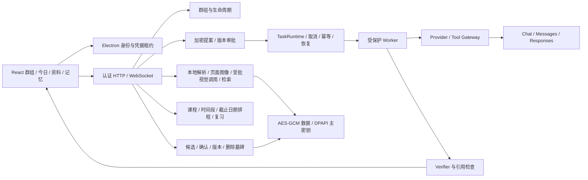

# StudyCrew 学伴团：架构与面试说明

StudyCrew 是 Hezhou Jiang 的 [Knowe](https://github.com/HirezmingD/Knowe-agent-groupchat) 的独立分叉，保留 MIT 许可证与上游署名。Electron 桌面壳、React 群聊体验、Python Agent 引擎及大量基础聊天/文件能力来自上游；不要把这些讲成从零实现。

本分叉新增的核心是群组权限与学习领域：任务版本审批、受保护执行与恢复、加密资料与记忆、可核验引用、课程考试与复习计划，以及可追溯评测。源码和验证记录是判断边界的依据，界面上的成功状态必须来自后端实际状态。

## 可以讲清的设计选择

- **审批对象是内容版本。** 批准绑定群组、任务提案摘要、版本与资料版本。旧卡片不能批准新任务，重复按钮不能产生第二次执行。
- **持久化先于外部效果。** 派发与工具/模型副作用有独立状态，重启后不自动重放状态不明的付费调用。失败、取消、暂停与部分核验是不同状态。
- **内容与权限分开。** 检索片段、模型返回与记忆均是不可信输入，不能授权工具。群组和资料版本必须在效果前后复核。
- **加密不等于万能隐私。** DPAPI 保护本地主密钥，内容使用带身份 AAD 的 AES-GCM。没有可用主密钥时拒绝需要保护的持久化，不能退回明文并声称已加密。旧版本历史数据、进程内存和使用者主动导出不自动被这项保证覆盖。
- **引用核验有边界。** 版本、页码、chunk 与原文精确引用能证明证据位置与新鲜度，不能自动证明推理语义正确。需要用户复核时用 partial 展示。
- **计划首先可执行。** 根据时段、截止日期、优先级排程并显示时间不足；延期/跳过会重新分配，练习更新掌握度和下一次复习，而不是只生成一段自然语言计划。
- **记忆先确认再参与召回。** 推断、偏好、成绩进入候选；确认、修改、删除都检查版本。删除墓碑防止同一句被重新学习；语义索引是可重建派生物，不能成为权限真源。目前产品使用显式课程记忆查询，没有声称所有 Agent 回答都会自动注入这些记忆。
- **语义记忆是真实的本地实现。** 使用固定版本 Mem0 2.0.20、E5 int8 ONNX 384 维向量和 USearch，在受控的短生命周期命名空间中投影已确认记录；远程抽取必须先批准，抽取结果还需单独确认。没有把 SDK 的自主写入或云遥测作为权限来源。
- **协议差异在适配层消化。** 三种提供方协议有不同路径、消息结构、工具返回和流式事件。模型能力按具体 ID 核实，不能从服务商品牌猜测视觉支持。

## 不应夸大的部分

学校接入是只读 Mock，无真实学校登录/成绩写入。通知依赖桌面应用或托盘仍在运行。确定性练习答案比对不是任意开放题判卷。字面引用校验不等于语义事实核验。120 条真实模型行为结果不等于 120 条桌面端到端测试。未完成的安装、Office 视觉或语义检索项目必须以最终交付报告中的实际结果为准。

资料回答当前使用显式标记的本地词法检索降级模式；记忆的语义检索通过不代表资料向量检索已经接通。保护后的群组内容采用加密真源和不含正文的历史引用，但旧私聊等历史路径不在“全部内容已加密”的声明范围内。Office 转换期间需要临时明文文件，正常结束会清理，进程崩溃后的清理尚未验证。

## 面试讲述顺序

先说明 Knowe 复用边界，再演示一个课程的真实数据流；重点讲一次旧审批拒绝、一次取消/重启恢复和一次错误引用。用评测报告展示失败样例与成本，解释为什么保留失败比展示全绿更能说明工程判断。最后展示源码中新增模块与验证命令，避免用 Agent 数量替代工程成果。

可用下面这段作为一分钟开场，按自己的实际投入调整措辞：

> StudyCrew 是基于 Knowe 的学习助手分叉，我复用了 Electron、React 和 Python Agent 的底座，重点补齐学习产品流程。用户建立课程和考试后可以生成有截止时间与可用时段约束的计划，再通过资料问答、练习和复习形成学习闭环。工程上的重点是让审批、真实执行和持久化状态保持一致：批准的是具体任务和资料版本，取消或重启不能让旧授权重新生效。资料引用和记忆都有来源与版本；推断出的记忆必须确认。模型层实际实现了三种协议，也做了固定 120 场景的真实评测。结果有失败，我会把模型行为失败、接口错误和应用权限测试分开解释，而不把一组 Mock 全绿当作产品验证。

| 常见追问 | 应讲清的证据 |
| --- | --- |
| 为什么还需要 Worker 外的网关？ | 模型生成工具参数不等于用户授权；网关复核当前群组、版本、能力、目的地和预算，工具结果不能提升权限。 |
| 用户批准后修改了资料怎么办？ | 来源版本进入审批和引用身份；执行/呈现前再次检查，旧引用与旧任务不能凭原审批继续访问新来源。 |
| 重试如何避免重复扣费？ | 请求前持久化预留，幂等键区分业务重放；不明结果保留费用上界并停止自动重放，恢复不等于重新发包。 |
| 为什么用 Mem0 又保留自己的数据库？ | SDK 负责抽取/去重/语义搜索；加密数据库负责最终权限、版本、删除和 TTL。临时 SDK 索引中的 ID 与内容都不能成为权限真源。 |
| 多模态做到了什么程度？ | PDF 页面和 Office 图表真实渲染后送入获批模型；有分页和输入预算。引用只保证原文/页码/版本，语义正确性仍需复核。 |
| 项目当前最需要改进什么？ | 展示 32 个真实评测失败，尤其排程字段理解；再说明资料语义检索、通知平台行为、干净机器部署和教学效果的验证边界。 |

不要把安装包能启动说成所有功能已验收，不要把学校 Mock 说成已接入教务，不要把未测过的模型能力或“全部聊天加密”作为卖点。最终数字以 [交付记录](STUDYCREW-DELIVERY-20261011.md) 为准。
